<p align="center">
  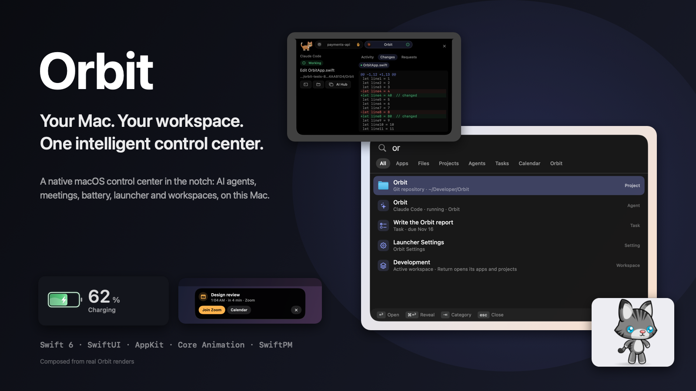
</p>

<h1 align="center">Orbit</h1>

<p align="center"><strong>Your Mac. Your workspace. One intelligent control center.</strong></p>

<p align="center">
  A native macOS control center that lives in the notch: AI coding agents, meetings,<br>
  battery and displays, a launcher and your workspaces, in one place, on your Mac.
</p>

<p align="center">
  Swift 6 · SwiftUI · AppKit · Core Animation · Swift Package Manager · macOS 26+ · Apple Silicon
</p>

---

Orbit is a personal, actively developed macOS app. Hover the notch (or press ⌃⌥⌘O) and a dashboard grows out of it; press ⌃⌥Space for the launcher (it also does sums, timers, Apple Shortcuts and a colour picker). It's built with public macOS APIs and Command Line Tools only, keeps its data on your Mac, and asks for a permission only when you use the feature that needs it.

**Status:** under active development. There is no published release or installer yet: you build and run it from source (see [Getting started](#getting-started)). Builds are ad-hoc signed, not notarized.

## Why Orbit

A Mac already has the information you need during a working day; it's just scattered: an agent waiting in a terminal, a meeting in Calendar, an app draining the battery, a file you meant to hand to an agent. Orbit gathers it where your eyes already go (the notch, or the top of the screen on a display without one) and connects it:

- **Context, not just widgets.** A local Context Engine reads what Orbit already knows (agents, meetings, tasks, focus, battery, workspace) and suggests one next step at a time, with the reason it appeared. Suggestions never act on their own.
- **Built around the notch.** The dashboard, the music island, the volume and brightness HUDs, meeting reminders and agent alerts share one slot below the notch with one priority order, so they never pile up. On a display without a notch, the same information appears as a floating pill below the menu bar.
- **Honest about what macOS allows.** Where a public API can't do something (set brightness, read an external monitor, tell which website uses energy), Orbit says so instead of guessing.

## What it does

Everything below is implemented unless marked otherwise. The full list, with what each feature needs, is in [docs/FEATURES.md](docs/FEATURES.md).

### Intelligent workspace

| | |
|---|---|
| **Universal Launcher** (⌃⌥Space) | Fuzzy search over apps, files (Spotlight's index, names only), projects, AI agent sessions, the File Shelf, tasks, goals, today's events, Settings and Orbit actions, plus a calculator and your Apple Shortcuts. Keyboard first; scripts are revealed in Finder, never run. |
| **Workspace Profiles** | Development, College, FixKaru, Personal or your own: projects, apps, task words, an Overview layout, music and focus choices. Switching changes Orbit only; apps open only when you click *Open Workspace*. |
| **Context Engine** | Reads Orbit's own models (no new monitoring) and ranks suggestions: an agent waiting, a meeting about to start, a paused focus session, low battery. Each shows why it appeared; dismiss, snooze or mark it not relevant, and it learns locally from those clicks. |
| **Quick Actions and Automations** | Contextual one-click actions, and simple *when → do* rules from a fixed list of safe actions (pause music, keep awake, start focus, open Calendar). |

<p align="center">
  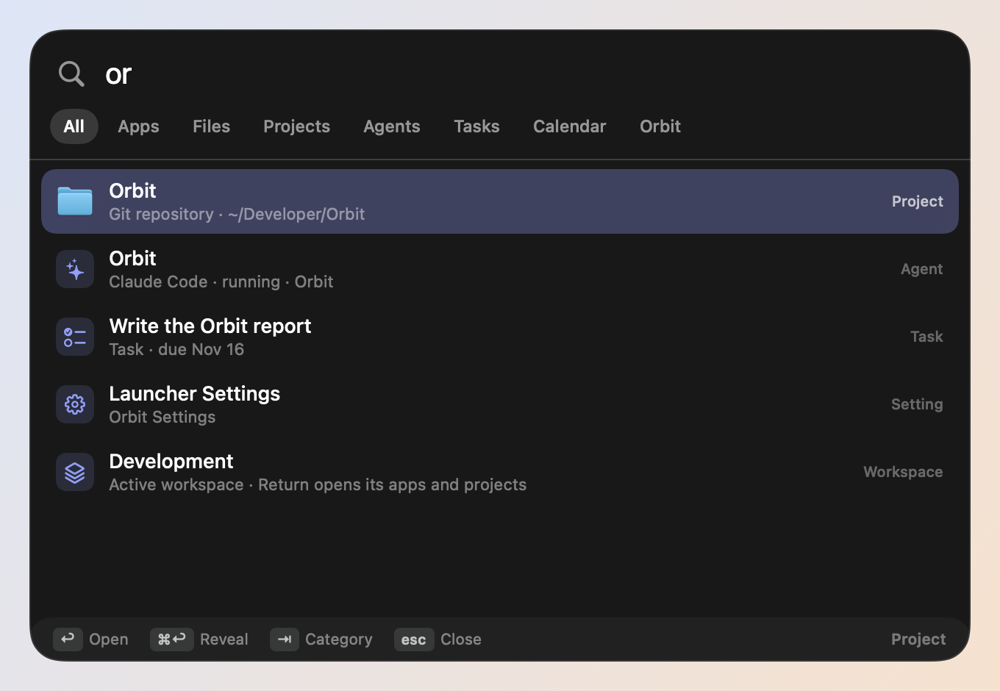
</p>
<p align="center">
  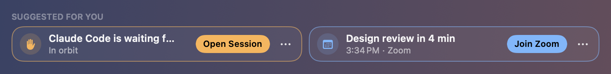
</p>

### AI Hub

Monitors AI coding agents on your Mac (Claude Code, OpenAI Codex, GitHub Copilot CLI, Gemini CLI, OpenCode and others, through local hooks or adapters): live sessions, timelines, files changed with diffs, insights, alerts when an agent needs you, and a jump to the agent's own window.

**The Claude Code integration is observe-only by design.** Orbit never answers its permission prompts or questions, and its hooks are written to `~/.claude/settings.json` only after you review and approve the change. A local chat talks only to model servers on your Mac (Ollama, LM Studio); cloud providers aren't supported yet.

<p align="center">
  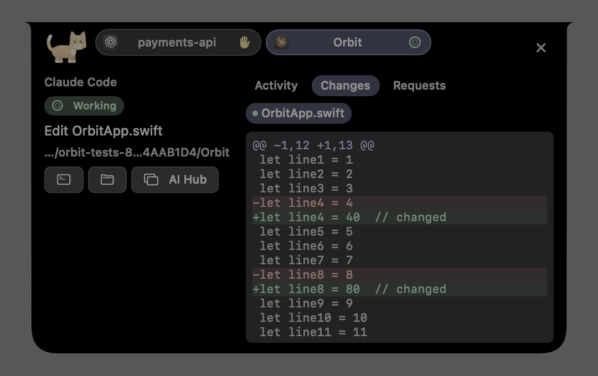
  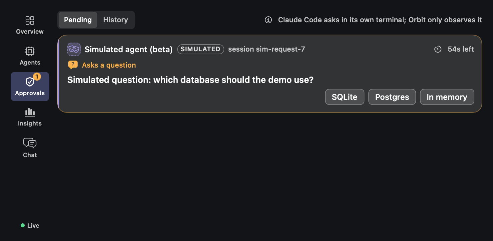
</p>

### Productivity

Tasks and daily goals, a focus timer, Calendar with meeting reminders and **Join** for Google Meet, Zoom, Teams and other https links, an interactive month grid, a clipboard history (off until you turn it on), a quick note, the File Shelf (park files as a reference or an explicit copy, never touching the original, and AirDrop them), *This Week* insights, and a Daily Digest that a model running on your Mac can optionally write.

<p align="center">
  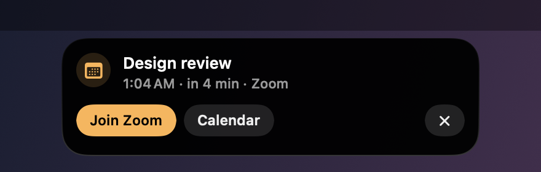
</p>

### System intelligence

| | |
|---|---|
| **Battery** | Five charge states, and *Apps Using Significant Energy* from macOS's own per-process energy counters, labelled as an estimate. |
| **Charging animation** | A Core Animation energy flow that runs only while the Mac is actually charging and the widget is on screen. |
| **Brightness** | The built-in display's real level (read-only), and a brightness HUD. |
| **System tab** | Wi-Fi details and diagnostics, Bluetooth devices, audio input and output, battery health, Keep Awake. |
| **Displays** | Wings beside the camera on a notched display, a floating pill on displays without one; follows display changes. |

<p align="center">
  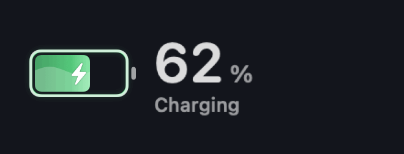
  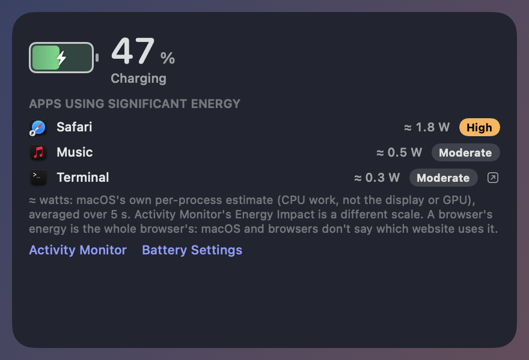
</p>

### Personal touches

A desktop pet (a cat or a dog, from free CC0 artwork) that walks, rests and sleeps on your desktop; a notch companion; the Music Island for Apple Music and YouTube in Brave, with optional lyrics; a note below the notch when Bluetooth headphones or other devices connect; and appearance settings.

<p align="center">
  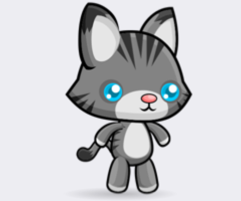
  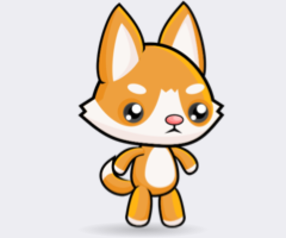
</p>

## What Orbit can't do

Being clear about this is part of the design:

- **Brightness is read-only.** Changing it needs private frameworks, and external monitors (DDC/CI) need private interfaces too, so they show as *not readable*.
- **Energy is per app, not per website.** Browsers don't expose per-tab energy, so a browser is shown as a whole. Figures cover CPU energy only.
- **No agent approvals for Claude Code.** Answer it in its own terminal or app.
- **LinkedIn** needs your own developer app and access the platform has to grant; the token is kept in memory only.
- **Sample widgets:** the *GitHub* and *AI Hub chat* widgets show sample data and are labelled *Sample*.
- Some features need an optional permission (Calendar; Location for Wi-Fi names and local weather; Bluetooth) or another app (Brave with Orbit's extension for YouTube; Ollama or LM Studio for local AI).

## Getting started

**Requirements:** macOS 26 or later; Apple Silicon (verified on a MacBook Air M4 with macOS 27.2; Intel is untested); Xcode Command Line Tools with Swift 6.2 or later (`xcode-select --install`). Full Xcode isn't needed.

```sh
git clone https://github.com/Awaneesh03/Orbit.git
cd Orbit
scripts/run.sh            # build, assemble Orbit.app, sign it ad hoc and launch it
scripts/test.sh           # run the test suite
```

The first build downloads the Rive runtime package (MIT) through Swift Package Manager. Always launch with `scripts/run.sh`: `swift run` starts the bare binary without its `Info.plist`, so it gets a Dock icon and no permission prompts. Release builds and the optional Brave helper are in [docs/INSTALLATION.md](docs/INSTALLATION.md).

## How it's built

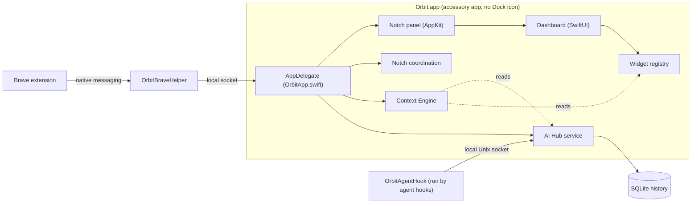

AppKit owns the windows, SwiftUI draws their content, and Core Animation runs the continuous effects outside Orbit's process. See [docs/ARCHITECTURE.md](docs/ARCHITECTURE.md).

## Privacy

Orbit keeps its data in `~/Library/Application Support/Orbit/` and uses the network only for features that need it: weather (Open-Meteo), news feeds, lyrics (LRCLIB, only if you turn them on), LinkedIn (only with your token) and model servers on `localhost`. It doesn't record the screen, read keystrokes or browser history, or send your activity anywhere. [docs/PRIVACY.md](docs/PRIVACY.md) covers each feature's data and permissions.

## Measured, not promised

On the development Mac (MacBook Air M4, macOS 27.2, debug build), sampled with `ps` and `vmmap` while idle with the dashboard closed: about 0.0–0.1 % CPU and a 36–41 MB physical footprint. Launcher queries took 3–11 ms over that Mac's apps and Spotlight results. These are single-machine observations, not benchmarks; your numbers will differ.

## Documentation

| | |
|---|---|
| [Features](docs/FEATURES.md) | Every feature, its status and what it needs |
| [Installation](docs/INSTALLATION.md) | Building, running, packaging, the Brave helper |
| [Architecture](docs/ARCHITECTURE.md) | How the app fits together, and how to extend it |
| [Privacy](docs/PRIVACY.md) | Data, network and permissions, feature by feature |
| [Troubleshooting](docs/TROUBLESHOOTING.md) | Known build and runtime issues |
| [Contributing](docs/CONTRIBUTING.md) | Development setup and guidelines |
| [Roadmap](docs/ROADMAP.md) | Done, in progress and planned |
| [AI Hub specification](docs/AI_HUB_SPEC.md) · [Pet characters](docs/PET_CHARACTERS.md) | Deeper technical specifications |
| [Development log](docs/ORBIT_ROADMAP.md) · [Project specification](PROJECT_SPEC.md) | Detailed milestone notes and history |

## License

No license has been chosen yet, so the code isn't licensed for reuse yet. Third-party assets keep their own licenses: the pet artwork is CC0 ([Resources/Pets](Resources/Pets)) and the Rive runtime is MIT.
