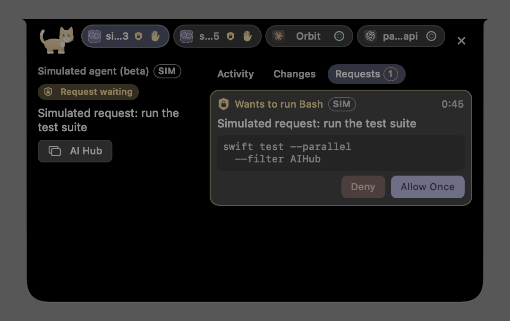

<div align="center">

# 🍎 Orbit

**A native macOS control center that lives in the MacBook notch.**

Hover the camera housing and a dashboard of widgets opens. Move away and it disappears.


</div>

---

## What it is

Orbit is a personal project for a notched MacBook (built and tested on an M4 MacBook Air). It is an accessory app: no Dock icon and no menu bar item. A single borderless panel sits invisibly over the notch. When the pointer enters it, the panel grows into a dashboard hanging from the top edge of the screen, and it closes again when the pointer leaves, on Escape, or when you click elsewhere. It works on every Space, including full-screen ones.

<div align="center">

| Agent request in the notch | Suggested for you |
|---|---|
|  |  |

</div>

## Features

### Dashboard widgets
Each widget is a small module that only does work while the dashboard is visible.

- **Everyday:** clock, weather, calendar events, tasks, goals, checklists, quick notes, news
- **Focus:** Pomodoro timer, eye-break reminders, daily digest and weekly insights
- **System:** battery, memory, storage, network, brightness, keep-awake
- **Productivity:** clipboard history (off by default and kept in memory only), file shelf, quick actions, GitHub and project widgets, Obsidian vault widget
- **Media:** now playing and a volume HUD in the notch

### AI Hub
A place to watch and steer coding-agent sessions from the notch.

- An agent registry with adapters, so different tools can report into the same view
- A local event bridge over a Unix socket (owner-only permissions, same-user check) that agent hooks write to
- An approvals queue: when an agent asks to run something, the request shows up in the notch with Deny and Allow Once
- Session history stored locally in SQLite
- A notch companion and desktop pets that react to what the agents are doing

Some agents are still simulated or unverified against the real tool. `docs/ORBIT_ROADMAP.md` marks each item as Implemented, Partial, Simulated, Unverified or Blocked.

### Notch
One arbiter decides who owns the notch at any moment (music island, volume HUD, companion, meeting pill), so overlays never fight each other.

## Project layout

```
Sources/
  Orbit/              the app: dashboard, widgets, notch, launcher, AI Hub, pets, settings
  OrbitBridge/        framing and Unix-socket code shared with the agent hook
  OrbitAgentHook/     hook helper: sends one agent event from stdin to Orbit's socket
  OrbitBraveHelper/   native messaging host for the Brave browser extension (BraveExtension/)
Tests/OrbitTests/     Swift Testing suites
docs/                 AI Hub spec, roadmap, pet characters, screenshots
scripts/              run.sh, test.sh and helper scripts
PROJECT_SPEC.md       the project specification and decision log
```

## Run it

You need macOS 26 or later and the Xcode Command Line Tools. Full Xcode is not required. The only external dependency is the [Rive](https://github.com/rive-app/rive-ios) runtime, which animates the desktop pets, and it is pinned in `Package.swift`.

```sh
git clone https://github.com/Awaneesh03/Orbit.git
cd Orbit
scripts/run.sh            # debug build; use `scripts/run.sh release` for release
scripts/test.sh           # run the tests through this script, not `swift test`
```

`scripts/run.sh` builds the package, assembles `Orbit.app` inside `.build/`, signs it ad hoc and relaunches it.

## Good to know

- **Command Line Tools only.** There are no asset catalogs, SwiftUI previews or SwiftUI macros, so view state lives in `@Observable` models. The reasons and workarounds are written up in `PROJECT_SPEC.md`.
- **Ad-hoc signing** changes the app's identity on every build, so macOS privacy grants such as Accessibility are reset after a rebuild. Sharing Orbit beyond one Mac would need a Developer ID and notarization.
- **Some things are impossible with public APIs** (for example lock-screen widgets). The roadmap names each one and the alternative.

## Docs

- [`PROJECT_SPEC.md`](PROJECT_SPEC.md) - architecture, constraints and the decision log
- [`docs/AI_HUB_SPEC.md`](docs/AI_HUB_SPEC.md) - the AI Hub specification
- [`docs/ORBIT_ROADMAP.md`](docs/ORBIT_ROADMAP.md) - milestones and their status
- [`docs/PET_CHARACTERS.md`](docs/PET_CHARACTERS.md) - the desktop pets

## Author

Built by [Awaneesh Gupta](https://github.com/Awaneesh03).
