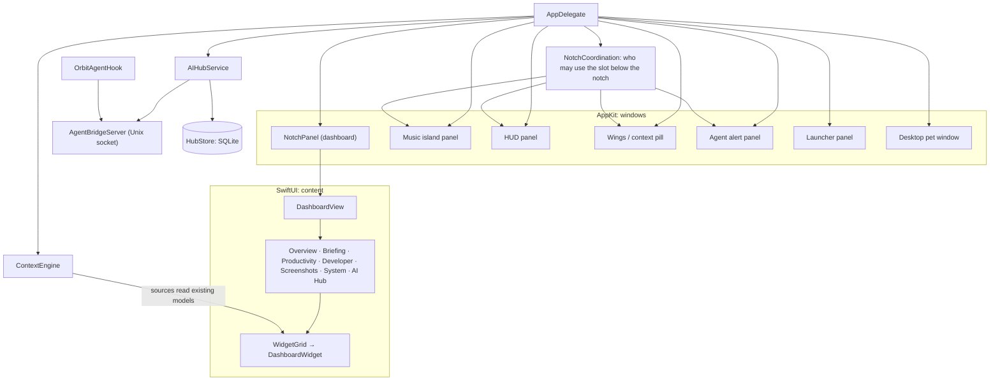

# Architecture

Orbit is a Swift Package with one macOS app and three small companions. This page describes how it fits together and how to extend it. Deeper design notes live in the [AI Hub specification](AI_HUB_SPEC.md) and the [project specification](../PROJECT_SPEC.md).

## Targets

| Target | Kind | Purpose |
|---|---|---|
| `Orbit` | executable | The app: an accessory app (`LSUIElement`, no Dock icon) |
| `OrbitBridge` | library | Message framing, validation and the local Unix socket, shared by the app and the helpers |
| `OrbitAgentHook` | executable | Run by agent hooks: forwards one agent event from stdin to Orbit's socket, prints nothing |
| `OrbitBraveHelper` | executable | Brave's native-messaging host for the YouTube now-playing integration |
| `OrbitTests` | tests | Swift Testing (`import Testing`); XCTest isn't available with Command Line Tools |

The only package dependency is [rive-ios](https://github.com/rive-app/rive-ios) (MIT, pinned to 6.29.0), a binary framework used by the pet's Rive engine. `scripts/run.sh` embeds it in `Orbit.app`.

## Source layout

```
Sources/Orbit/
  OrbitApp.swift   AppDelegate: owns the panels, models and services, and wires them together
  Dashboard/       DashboardModel, the dashboard view, sections, the System tab, glass controls
  Notch/           Notch panel, coordination, HUDs, music island, wings, context pill, meetings
  Widgets/         DashboardWidget protocol, registry, layout, and every widget
  Services/        Calendar, weather, news, network, energy, brightness, automations, workspaces…
  AIHub/           Agent models, bridge server, adapters, history store, session views, alerts
  Context/         Context Engine and the "Suggested for You" views
  Launcher/        Universal Launcher model and panel
  Pet/             Desktop pet, notch companion, rig, sprite and Rive skins
  Settings/        Preferences and the Settings window
Resources/         Info.plist and the CC0 pet characters
BraveExtension/    The optional Brave extension
scripts/           run.sh, test.sh, install-brave-helper.sh, build-pet-atlases.swift
```

## The big picture



### Windows and interaction

AppKit owns every window; SwiftUI draws their content. The dashboard is one borderless, non-activating `NSPanel` at status-bar level. While idle it's an invisible hover target over the camera housing (or a top-centre strip on a display without a notch); on hover, or with ⌃⌥⌘O, it grows into the 740×420 pt dashboard. View state lives in `@Observable` models such as `DashboardModel`, because SwiftUI's `@State` is a macro that ships only with full Xcode.

### One slot below the notch

The music island, the volume and brightness HUDs, agent alerts, the eye-break reminder, Bluetooth device notices, the status pill and the notch companion all use the same place. `NotchCoordination` holds one table of priorities (dashboard › expanded player › volume HUD › brightness HUD › compact island › agent alert › eye break › device notice › status pill › companion) and decides who holds the slot from the same live inputs. While Coucou (another notch app) runs, everything except the dashboard steps aside; turning Settings › Notch › Use the notch off makes the owner `.off`, which does the same.

The dashboard (`Dashboard/DashboardView.swift`, Milestone 21) grows out of the notch: the surface is the camera housing's size when closed and springs to the panel's size when open, masking the content as it grows; closing uses a shorter spring without overshoot, and Reduce Motion or Low Power Mode makes it a fade. The row beside the camera is the header (time, battery from `PowerWatcher`, a running `QuickTimer`, the section tabs).

### Display awareness

`DisplayProfile` describes the primary display. On a notched display with *Beside the camera* selected, contextual status appears in wings around the camera; elsewhere, as a floating pill below the menu bar. Panels reposition on display changes and on wake.

### Widgets

Every dashboard card is a `DashboardWidget`: metadata (id, title, category, availability, presentations), a load state, `start()`/`stop()` called as it becomes visible or hidden, and `content(_:)`. `WidgetRegistry.builtIn` lists them; `WidgetLayout` stores the user's order and sizes. Widgets do no work while hidden.

### Local persistence

Settings and widget data are small JSON files in `~/Library/Application Support/Orbit/`, read and written through `JSONFile` and `Persisted` (tolerant decoding: a missing or invalid field takes its default, an unreadable file is kept aside rather than overwritten). The AI Hub keeps its history in SQLite.

### AI Hub event flow

Agents report through hooks or adapters. A hook runs `OrbitAgentHook`, which sends one event over a Unix socket in Orbit's folder. `AgentBridgeServer` accepts it, `AgentEventRouter` validates and redacts it (tokens, keys and passwords are masked) and routes it to `AgentSessionManager`, which updates live sessions; `HubStore` saves it. Views, alerts, the notch companion and the Context Engine read the resulting models.

### Context Engine

`ContextEngine` reads registered `ContextSource`s (workspace, AI Hub, calendar, tasks, focus, battery and energy, music, shelf, displays, automations) inside `withObservationTracking`, so a change in any model they read schedules one coalesced refresh; nothing polls. `SuggestionRules` turns the snapshot into suggestions, and `SuggestionRanking` orders them and records why others were held back. The engine wakes on its own only at known times (an expiry, a snooze ending, a focus run ending).

### Core Animation

Continuous effects (the charging animation, the music equalizer, the pet rig) are Core Animation layers, so the window server runs them rather than Orbit redrawing SwiftUI every frame.

## Extending Orbit

### Add a widget

1. Create a class conforming to `DashboardWidget` in `Sources/Orbit/Widgets/` with a `WidgetMetadata` (a unique `id`, a category, `availability: .live`, or `.sample` for mock data). Use `isEnabledByDefault: false` so existing users' Overviews don't change.
2. Start any work in `start()` and stop it in `stop()`; keep state in an `@Observable` model, not `@State`.
3. Persist data with `JSONFile`/`Persisted` under the data directory passed to `WidgetRegistry.builtIn`.
4. Add one line to `WidgetRegistry.builtIn`, and add the id to `builtInOrder` in `Tests/OrbitTests/WidgetRegistryTests.swift`.
5. Add tests for its states, and render it in a test if it has a visual (see the existing render tests).

### Add a Context Engine source

1. In `startContextEngine()` (`OrbitApp.swift`), register a `ContextSource(id:name:read:)` whose `read` copies values from an existing model into `ContextSnapshot`. Read observable properties: that's what makes the engine refresh when they change. Don't add a new monitor or timer.
2. If the source enables new suggestions, add a rule in `SuggestionRules.generate` with a clear `reason`, a category, a priority and an expiry where it matters.
3. Cover it in `Tests/OrbitTests/ContextEngineTests.swift`, including when the data is unavailable.

### Add an AI Hub adapter safely

Read the [adapter contract](AI_HUB_SPEC.md#4-adapter-contract) first. In short:

- Prefer a manifest-driven hook adapter (`AdapterManifests.swift`, `HookAdapter.swift`) that maps an agent's own events to Orbit's `AgentEvent` kinds; add the agent to `AgentDiscovery.known` if it can be detected by a known install path.
- Adapters observe. An adapter may answer an agent's approval only if it declares that capability, and Claude Code never does (decision D1).
- Never open a network listener (D2) or store credentials (D3). Events arrive through the local socket and are validated and redacted by the router.
- Add tests with recorded, anonymised sample events.
